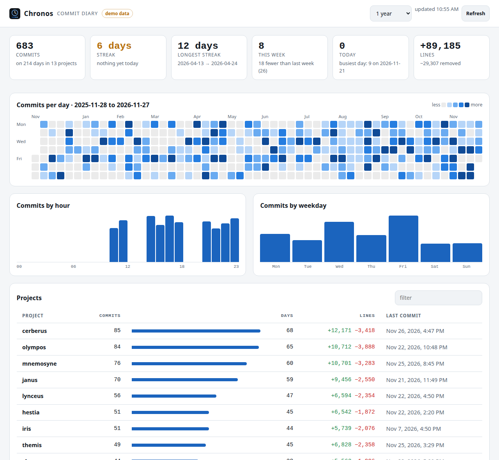
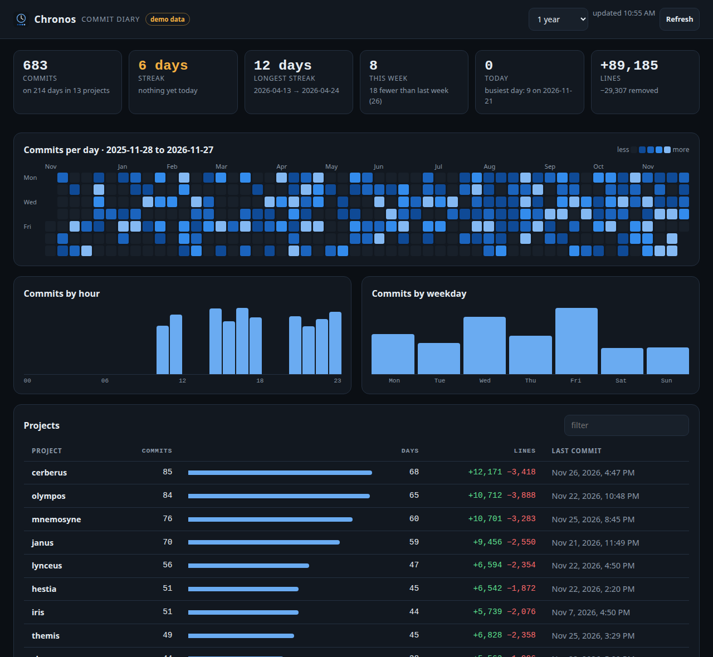
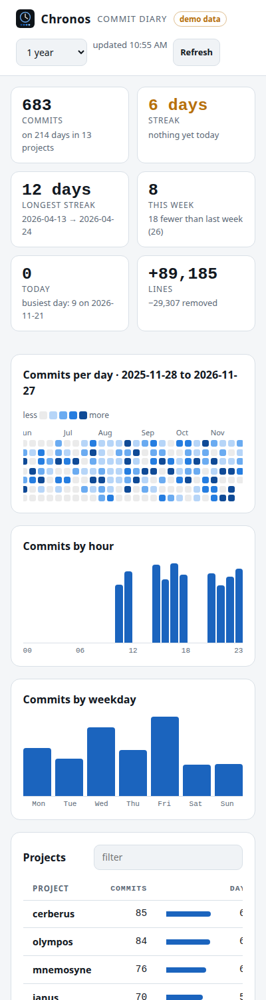
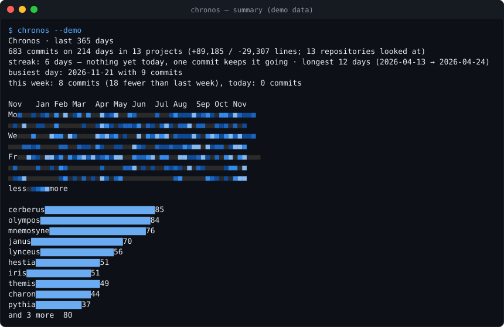
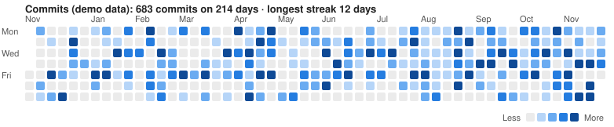
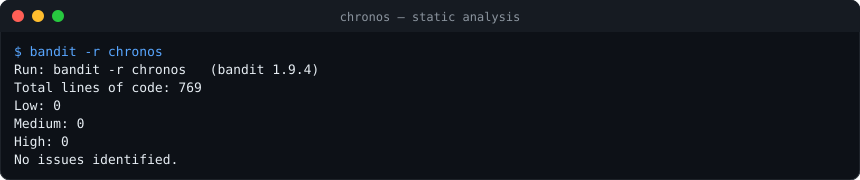
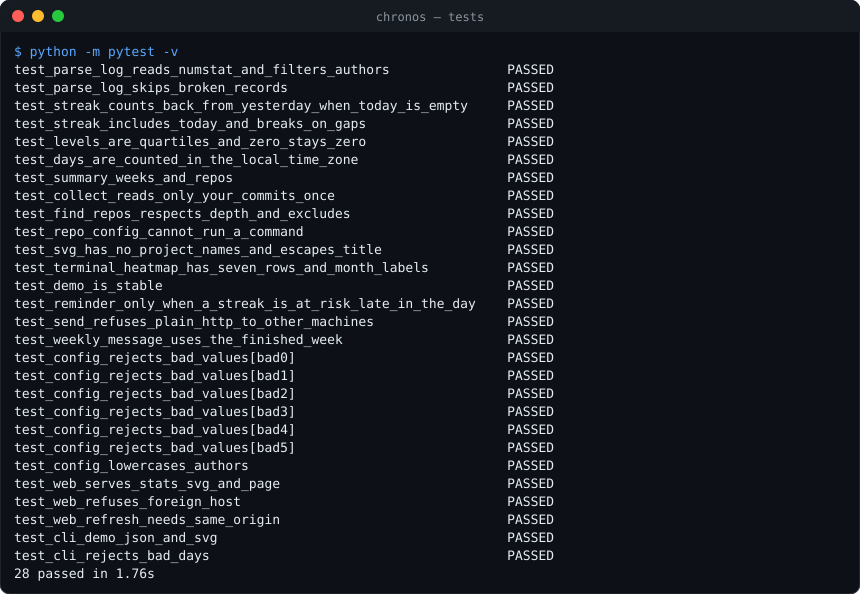

# Chronos

[](https://github.com/fas0ftware/chronos/actions/workflows/ci.yml)


A diary of your commits across every repository on your machine: how many you made today
and this week, how long your streak is, which projects got your time, and at what hours.
Private and unpushed work counts too, because it reads the local repositories, not GitHub.

Named after the Greek god of time.



<details>
<summary>Dark theme, phone, terminal</summary>





</details>

The screenshots use the built-in demo data (`--demo`): made-up commits on the author's public
project names.

## Contents

- [What it shows](#what-it-shows)
- [Quick start](#quick-start)
- [A heatmap for your profile README](#a-heatmap-for-your-profile-readme)
- [Reminders and the weekly summary](#reminders-and-the-weekly-summary)
- [Settings](#settings)
- [Security and privacy](#security-and-privacy)
- [Testing](#testing)
- [Project layout](#project-layout)
- [Roadmap](#roadmap)

## What it shows

| | |
|---|---|
| **Totals** | commits, active days, projects, lines added and removed in the chosen period (30 days to a year) |
| **Streak** | days in a row with at least one commit. An empty *today* does not break it yet: it says "nothing yet today" until midnight |
| **Longest streak** | with its first and last day |
| **This week** | Monday to today, against the whole of last week |
| **Heatmap** | one square per day, darker for busier days (the four shades are quarters of your own busy days, so a quiet year still shows its pattern) |
| **Hours and weekdays** | when your commits happen |
| **Projects** | commits, active days, lines and last commit per repository |
| **Latest commits** | the last 30, newest first |

Each commit is counted once even if it sits in two clones or on several branches. Merge
commits are left out. Days follow your computer's time zone.

## Quick start

Python 3.11 or newer, no packages to install.

```bash
git clone https://github.com/fas0ftware/chronos && cd chronos
python -m chronos --demo                 # try it on made-up commits
cp chronos.example.toml chronos.toml     # then set roots (and authors)
python -m chronos                        # summary in the terminal
python -m chronos week                   # this week against last week
python -m chronos serve                  # the page on http://127.0.0.1:8747
python -m chronos json                   # everything as JSON
```

Without a settings file it looks at the current folder and the folders under it.
`--days N` changes the period (default 365).

## A heatmap for your profile README

```bash
python -m chronos svg -o heatmap.svg --title "Commits"
```



The image holds only dates and counts, never project names or commit messages, so it is
safe to publish even when some of the work is in private repositories. It follows the
reader's light or dark theme on its own.

## Reminders and the weekly summary

Both send a message to [Iris](https://github.com/fas0ftware/iris) (or any ntfy-compatible
address) set as `iris_url`; with `--dry-run`, or with no address set, they print it instead.

- `chronos remind`: in the evening (after `remind_after`, default 20:00), when a streak is
  running and today has no commit yet: *"No commit yet today. One commit before midnight
  keeps the 6-day streak going."* Otherwise it stays quiet.
- `chronos weekly`: last week's commits, active days, projects and the three busiest
  projects. Meant for Monday morning.

Ready-made systemd user units are in [`contrib/systemd/`](contrib/systemd): a reminder at
21:00, the summary on Monday at 09:05, and the page as a service. Edit `WorkingDirectory`,
copy them to `~/.config/systemd/user/`, then:

```bash
systemctl --user daemon-reload
systemctl --user enable --now chronos-remind.timer chronos-weekly.timer
```

## Settings

`chronos.toml` next to the checkout, `~/.config/chronos/config.toml`, or `--config FILE`
(`CHRONOS_CONFIG` works too). See [`chronos.example.toml`](chronos.example.toml).

| Key | Default | Meaning |
|---|---|---|
| `roots` | current folder | folders that hold your repositories |
| `depth` | `2` | how many levels under each root to look (0–4); `node_modules`, `.venv`, `target` and hidden folders are skipped |
| `authors` | each repository's `user.email` | your commit e-mail addresses. Add every one you use: GitHub's noreply address, a work address, the address an assistant commits with in your repositories |
| `exclude` | none | folder names to skip |
| `private` | none | folder names shown only as "private project" |
| `all_branches` | `true` | count every local branch, or only the checked-out one |
| `iris_url` | none | where `remind` and `weekly` send to |
| `remind_after` | `20` | the reminder stays quiet before this hour |

## Security and privacy

- **Read-only.** It runs `git log` and `git config user.email` with a fixed argument list, no
  shell. A repository's own config cannot make it run a program: every call passes
  `core.fsmonitor=false` (tested with a repository whose fsmonitor would create a file).
  It never fetches, never writes to a repository.
- **Only your commits.** When no address matches a repository, it counts nothing there
  rather than everybody's work.
- **E-mail addresses stay out of every output**: the terminal, JSON, page and image only
  hold project names, times, messages and line counts. The SVG image holds dates and counts
  only.
- **The page** listens on 127.0.0.1 only, checks the `Host` header (DNS rebinding), accepts
  its one POST (`/api/refresh`) only from itself with JSON, sends a strict
  Content-Security-Policy and inserts every value as text.
- **Notifications** go over plain http only to this machine; anything else must be https.
- Your settings (folders, addresses) stay in the ignored `chronos.toml`.



## Testing

```bash
pip install -r requirements-dev.txt
python -m pytest -q
```

The tests build real git repositories in a temporary folder (other authors, a second
branch, a nested folder, a `node_modules` to skip, a hostile `core.fsmonitor`), check the
streak and week arithmetic across time zones, the image's privacy, the page's Host and
Origin checks, and the command line.



## Project layout

```
chronos/
  scan.py      find repositories, read git log (safe flags), keep only your commits
  stats.py     days, streaks, shades, weeks, per-project totals
  render.py    terminal summary and heatmap, the SVG image
  notify.py    reminder and weekly messages, sending to Iris
  web.py       the page's API (cached for a minute)
  web_base.py  the small 127.0.0.1-only server shared by FA Software tools
  demo.py      made-up commits, the same every run
  static/      the page
contrib/systemd/  reminder, weekly summary and page units
```

## Roadmap

- [ ] A Chronos panel in [Olympos](https://github.com/fas0ftware/olympos): streak and this week next to the project list
- [ ] Goals: "5 active days a week", shown as a ring
- [ ] Compare two periods side by side
- [ ] Tags from commit messages (fix, docs, deps) as a breakdown
